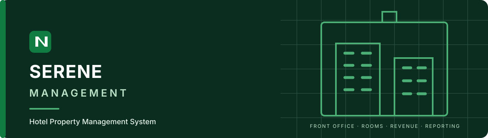
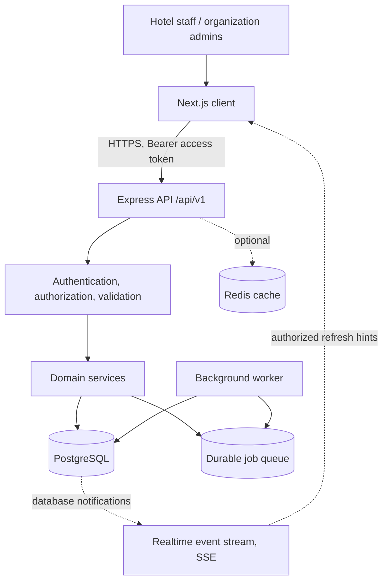
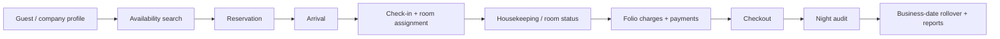

<div align="center">


  <p><strong>A unified operations workspace for modern hospitality teams.</strong></p>

  <p>
    <a href="https://github.com/syedasjadabbas/serene-management/actions/workflows/ci.yml"></a>
    
    
    
    
    
    
    
  </p>
</div>

---

## Overview

**SERENE MANAGEMENT** is a web-based Property Management System (PMS) for hotel organizations operating one or multiple properties. It brings front-office operations, reservations, guest profiles, rooms, housekeeping, billing, rates, reporting, and night audit into one permission-aware workspace.

The interface uses a clean, green-accented enterprise design system with responsive top navigation. The repository holds two applications that run as separate processes, a Next.js client and an Express API server (plus an optional background worker), sharing contracts through a workspace package. The system is built around server-enforced permissions, property isolation, transaction-safe financial records, and an auditable operational history.

> **Project status:** Application code and workflows have been developed and tested. Hosting, DNS, TLS, production database operations, scheduled workers, backups, and monitoring must be configured for the target environment; this repository does not imply a publicly deployed service.

## Product areas

<table>
  <tr>
    <td width="50%" valign="top">
      <h3>🛎️ Front office</h3>
      Reservations, availability, arrivals, walk-ins, check-in/out, room assignment, room moves, stay extensions, and same-day reverse check-in where business rules permit.
    </td>
    <td width="50%" valign="top">
      <h3>👤 Guest relationships</h3>
      Guest profiles, stay history, preferences, notes, company accounts, contacts, groups, room blocks, and loyalty records.
    </td>
  </tr>
  <tr>
    <td width="50%" valign="top">
      <h3>🧹 Rooms & operations</h3>
      Room board, housekeeping task assignment and inspection, room readiness, maintenance requests, and out-of-order/out-of-service states.
    </td>
    <td width="50%" valign="top">
      <h3>💳 Revenue & billing</h3>
      Rate plans, seasonal rates, restrictions, packages, folio windows, charges, payments and advance deposits recorded by the system (credit balances are refunded or settled before check-out), adjustments, voids, refunds, and balances.
    </td>
  </tr>
  <tr>
    <td width="50%" valign="top">
      <h3>🌙 Night audit</h3>
      Readiness checks, queued audit execution, business-date rollover, run history, and recovery flows through the background worker architecture.
    </td>
    <td width="50%" valign="top">
      <h3>📊 Reporting & oversight</h3>
      Operational and financial reports, CSV export, organization-level views, user and role management, audit trail, and cross-property visibility where authorized.
    </td>
  </tr>
</table>

### At a glance

- **Multi-property:** organization-level oversight with property-scoped operational data.
- **Role-based access control:** navigation is permission-aware and every protected API operation is authorized server-side.
- **Auditable operations:** high-risk changes require reasons where defined by the workflow; audit history preserves the operational trail.
- **Data integrity:** PostgreSQL constraints and transactional service workflows protect important records.
- **Responsive UI:** desktop, tablet, and mobile layouts for operational screens.
- **Search and filters:** property-aware global search plus server-backed list filtering.
- **Realtime-capable:** selected operational boards can refresh from database-backed events when realtime is configured.
- **Offline mode:** a limited read-only snapshot for supported front-office views; offline writes are not supported.

## Visual architecture



### Typical hotel workflow



> The diagram illustrates the principal operational flow. Individual actions remain subject to the configured role permissions, property settings, room status, and business rules.

## Technology stack

| Layer                   | Technologies                                                                                                   |
| ----------------------- | -------------------------------------------------------------------------------------------------------------- |
| Web client              | Next.js 16 App Router (pure client, no API routes), React 19, TypeScript strict mode                           |
| API server              | Express 5 on Node.js, TypeScript, JWT via `jose`, Zod request validation                                       |
| Styling and UI          | Tailwind CSS v4, shared UI primitives, Lucide icons                                                            |
| State and data fetching | Redux Toolkit / RTK Query, Zustand                                                                             |
| Validation              | Zod (contracts shared by client and server in `@serene/shared`)                                                |
| Cache (optional)        | Redis via `ioredis` for session and permission caches; in-process memory fallback when `REDIS_URL` is unset    |
| Database                | PostgreSQL 17+ (tested with PostgreSQL 18)                                                                     |
| ORM / migrations        | Prisma 7 with `@prisma/adapter-pg`                                                                             |
| Authentication          | Bearer access token (JWT) in client memory, rotated httpOnly refresh cookie, Argon2 password hashing           |
| Testing                 | Vitest, database-rule tests, API integration tests, browser QA                                                 |
| Operations              | Compiled operational scripts for migrations, seed/bootstrap, backups, maintenance, posture checks, and workers |

## Architecture principles

- **Server-side authorization is authoritative.** Hiding a link or button is a usability feature, not the security boundary.
- **Property and organization scopes are enforced on the server.** A user must not gain access by editing a URL or API request.
- **Financial records are treated as auditable ledger activity.** Posted history should not be silently rewritten.
- **Concurrency is handled explicitly.** Critical mutations use transaction boundaries, state checks, versions, and idempotency mechanisms where implemented.
- **Background work is durable.** Long-running work such as night audit is processed by a separate worker rather than depending on a browser request remaining open.
- **Operational configuration is explicit.** Database pooling, realtime connections, worker execution, trusted proxy hops, and secrets must match the hosting environment.

## Getting started locally

### Prerequisites

- Node.js **22.12 or newer**
- Native PostgreSQL **17 or newer** with `psql` available (`npm run verify` runs integration tests against it)
- Redis is optional and not needed locally
- Git
- Windows PowerShell is supported for the native PostgreSQL setup workflow
- **Docker is not required or used by the documented local setup**

### 1. Install dependencies

```powershell
npm ci
```

### 2. Create your local environment files

Each workspace has its own example file (the root `.env.example` only points to them):

```powershell
Copy-Item server\.env.example server\.env
Copy-Item client\.env.example client\.env.local
```

Edit `server/.env` locally. Set a valid `DATABASE_URL` for the local application role and generate distinct, strong authentication secrets. `client/.env.local` only needs `NEXT_PUBLIC_API_URL` (default `http://localhost:4000/api/v1`). A root `.env` is still read by the server as a fallback, but new setups should use `server/.env`. Never commit `.env` or paste secret values into issues, chat, or logs.

### 3. Prepare native PostgreSQL

Run the database setup script once. It creates or updates the application role and the development/test databases, prompting for the PostgreSQL administrator password when required. It requires a password of **at least 16 characters** for the application role in `DATABASE_URL`.

```powershell
npm run db:setup
```

To use a shorter password locally, create the role and databases by hand instead, as the `postgres` superuser in `psql` (names must match `DATABASE_URL`):

```sql
CREATE ROLE serene LOGIN CREATEDB;
\password serene
CREATE DATABASE serene_management OWNER serene ENCODING 'UTF8' TEMPLATE template0;
CREATE DATABASE serene_management_test OWNER serene ENCODING 'UTF8' TEMPLATE template0;
REVOKE ALL ON DATABASE serene_management FROM PUBLIC;
REVOKE ALL ON DATABASE serene_management_test FROM PUBLIC;
```

### 4. Apply migrations and seed reference data

```powershell
npm run db:deploy
npm run db:seed
```

The `db:*` scripts run from the repository root and forward to the `server` workspace. `db:seed` loads reference data by default. To create the fictional demo organization locally, set `SEED_DEMO=true` and a strong `SEED_DEMO_PASSWORD` (16+ characters, varied, not a placeholder) in `server/.env` before seeding. The demo seed is refused when `NODE_ENV=production`; do not use shared demo credentials for a public or production environment.

The demo creates organization **SERENE** with two properties, **SMR** (Asia/Karachi, PKR) and **SDX** (Asia/Dubai, AED), rooms, rates, sample reservations, guests and a loyalty program, and these staff accounts, all signing in with `SEED_DEMO_PASSWORD`:

| Account                                          | Role                                   |
| ------------------------------------------------ | -------------------------------------- |
| `admin@serene.test`                              | Organization Admin (both properties)   |
| `gm.smr@serene.test`, `gm.sdx@serene.test`       | General Manager of SMR / SDX           |
| `fom.smr@serene.test`, `agent.smr@serene.test`   | Front Office Manager, Front Desk Agent |
| `hksup.smr@serene.test`, `hk.smr@serene.test`    | Housekeeping Manager, Housekeeper      |
| `chief.smr@serene.test`, `maint.smr@serene.test` | Maintenance Manager, Maintenance Staff |
| `auditor@serene.test`                            | Auditor (read-only, financial reports) |

The seed sets the password only when it creates the accounts; changing `SEED_DEMO_PASSWORD` later does not change existing users.

### 5. Start the API server and the client

Two processes, in two terminals:

```powershell
npm run dev:server   # Express API on http://localhost:4000 (health: /api/health)
npm run dev:client   # Next.js client on http://localhost:3000
```

Open [http://localhost:3000](http://localhost:3000). The client calls the API at `NEXT_PUBLIC_API_URL`; the server accepts browser calls from `CLIENT_ORIGINS` (default `http://localhost:3000`).

If ports 3000 or 4000 are already in use, pick others and keep the three settings in step:

```powershell
# server/.env:        PORT=4100   and   CLIENT_ORIGINS="http://localhost:3001"
# client/.env.local:  NEXT_PUBLIC_API_URL=http://localhost:4100/api/v1
npm run dev:server
npm run dev:client -- -p 3001
```

`NEXT_PUBLIC_API_URL` is read when the client starts or builds, so restart the client after changing it.

### 6. Run the full verification suite

```powershell
npm run verify
```

This runs typecheck, lint, unit and database-rule tests, integration tests (against the local `serene_management_test` PostgreSQL database), and production builds of the server and client. You can also run the individual scripts below.

## Useful scripts

| Command                    | Purpose                                                                                           |
| -------------------------- | ------------------------------------------------------------------------------------------------- |
| `npm run dev:server`       | Start the Express API in watch mode (port 4000)                                                   |
| `npm run dev:client`       | Start the Next.js client dev server (port 3000)                                                   |
| `npm run build`            | Build the server (API, worker, ops scripts) and the client                                        |
| `npm run typecheck`        | Typecheck every workspace (the client also generates route types)                                 |
| `npm run lint`             | Run ESLint and the per-workspace architecture-boundary rules                                      |
| `npm run test`             | Run the unit and database-rule suites                                                             |
| `npm run test:integration` | Run API integration tests against native PostgreSQL (`serene_management_test`)                    |
| `npm run verify`           | Typecheck, lint, unit tests, integration tests, build                                             |
| `npm run db:setup`         | Prepare the native PostgreSQL role and local databases                                            |
| `npm run db:deploy`        | Apply existing migrations                                                                         |
| `npm run db:seed`          | Seed development/reference data                                                                   |
| `npm run db:validate`      | Validate the Prisma schema                                                                        |
| `npm run ops:seed`         | Seed production reference data (dry run by default; write with `--apply --yes --database <name>`) |
| `npm run ops:bootstrap`    | Create the first organization and administrator (same dry-run default and write flags)            |
| `npm run ops:db-check`     | Check database posture and integrity settings                                                     |
| `npm run ops:backup`       | Create, verify, list, and restore database backups                                                |
| `npm run ops:maintenance`  | Prune expired operational records (dry run by default)                                            |
| `npm run worker`           | Run the durable background-job worker (`server/dist/workers/worker.mjs`, needs `npm run build`)   |

The `ops:*` and `worker` scripts run compiled output, so run `npm run build` first. Operator commands that write are dry runs unless given `--apply --yes --database <name>` (see [`docs/OPERATIONS.md`](docs/OPERATIONS.md)).

## Authentication, roles, and tenant boundaries

Users are assigned role templates at organization or property scope. The client computes the navigation appropriate to a user's grants, and the API independently checks permissions on every request. Common roles include Organization Admin, General Manager, Front Office Manager, Front Desk Agent, Reservations Agent, Housekeeping Manager, Housekeeper, Maintenance Manager, Maintenance Staff, Cashier, Accountant, and Auditor.

- Organization-wide tools appear only for users with the relevant organization access.
- The property switcher is interactive when the account can access multiple properties; a single-property account may see a static property identity instead.
- Do not broaden navigation or API permissions just to make two accounts look the same. Expected navigation differs by role.
- High-risk operations may require a reason and create audit entries.
- Sign-in issues a short-lived access token kept in memory and a rotating httpOnly refresh cookie; reloading the page restores the session from the cookie.
- Each user has **one active session per platform** (web or mobile): signing in again on the same platform ends the previous session.
- A few catalog permissions (cashiering, invoices, credit notes, folio routing, room upgrades and holds, guest merge and privacy, commissions, lost and found) are **reserved**: role templates grant them, but no feature uses them yet.

See [`docs/RBAC.md`](docs/RBAC.md) for the authoritative permissions catalog.

## Offline behavior

The offline experience is deliberately **read-only**. It can display the supported cached shell and limited, recently saved front-office snapshot when the connection is unavailable. Snapshots are scoped and have expiry/clearing rules.

The application does **not** support creating reservations, checking guests in or out, room moves, housekeeping writes, posting charges, processing payments, or running night audit while offline. Reconnect before performing operational writes.

Details: [`docs/OFFLINE_ARCHITECTURE.md`](docs/OFFLINE_ARCHITECTURE.md).

## Integrations and deployment considerations

The repository includes deployment and operations tooling, but successful local verification is not the same as a live production deployment. Before serving a real hotel, configure and validate the target environment's database, secrets, TLS, backups, monitoring, worker process, schedules, and recovery procedures.

Items that require separate infrastructure or client/provider configuration include:

- hosting, DNS, HTTPS/TLS, environment secrets, database operations, encrypted off-host backups, and monitoring;
- two always-on processes (API server and client) behind a reverse proxy, plus an always-on background worker for queued work such as night audit;
- optionally Redis, to share session and permission caches between API instances;
- realtime database connections and proxy behavior when realtime is enabled;
- email/SMS delivery for invitation and reset links (the current workflow can hand links to an administrator);
- payment-gateway/card-terminal processing, channel-manager connectivity, and accounting-system integration.

The application records supported payments in its own ledger; that is not the same as charging a card through a payment provider. Configure and test external integrations before representing them as active.

Deployment reference: [`docs/DEPLOYMENT.md`](docs/DEPLOYMENT.md) · Operations: [`docs/OPERATIONS.md`](docs/OPERATIONS.md).

## Documentation map

| Document                                                           | What it covers                                                                           |
| ------------------------------------------------------------------ | ---------------------------------------------------------------------------------------- |
| [`docs/CLIENT_HANDOVER.md`](docs/CLIENT_HANDOVER.md)               | User roles, setup order, daily operations, business rules, limitations, and dependencies |
| [`docs/ARCHITECTURE.md`](docs/ARCHITECTURE.md)                     | Application architecture, runtime, boundaries, and design decisions                      |
| [`docs/DOMAIN_MODEL.md`](docs/DOMAIN_MODEL.md)                     | Domain entities, relationships, and state machines                                       |
| [`docs/DATABASE_DESIGN.md`](docs/DATABASE_DESIGN.md)               | PostgreSQL/Prisma conventions and data-integrity rules                                   |
| [`docs/PMS_WORKFLOWS.md`](docs/PMS_WORKFLOWS.md)                   | End-to-end hotel operational workflows                                                   |
| [`docs/API_CONVENTIONS.md`](docs/API_CONVENTIONS.md)               | API shape, validation, errors, and conventions                                           |
| [`docs/RBAC.md`](docs/RBAC.md)                                     | Roles and permission catalog                                                             |
| [`docs/IMPLEMENTATION_ROADMAP.md`](docs/IMPLEMENTATION_ROADMAP.md) | Development phases and completion criteria                                               |
| [`docs/DEPLOYMENT.md`](docs/DEPLOYMENT.md)                         | Environment setup, deployment, migrations, and bootstrap                                 |
| [`docs/OPERATIONS.md`](docs/OPERATIONS.md)                         | Backups, restore drills, maintenance, monitoring, and runbooks                           |
| [`docs/SERVER_SPLIT_PLAN.md`](docs/SERVER_SPLIT_PLAN.md)           | The split into Express server, Next.js client, and shared package (decisions, layout)    |
| [`docs/PRODUCTION_READINESS.md`](docs/PRODUCTION_READINESS.md)     | Production-readiness findings, prerequisites, and known risks                            |
| [`docs/SECURITY.md`](docs/SECURITY.md)                             | Security model and controls                                                              |
| [`docs/OFFLINE_ARCHITECTURE.md`](docs/OFFLINE_ARCHITECTURE.md)     | Offline data scope, expiry, and security behavior                                        |

## Project structure

```text
shared/    @serene/shared: Zod contracts, types, pure policies, permission catalog, utilities (no Prisma, no React)
server/    Express API
  app.ts, index.ts   application factory and process entry
  config/            validated environment, Prisma client
  lib/ middlewares/  infrastructure and the request middleware chain
  modules/           per feature: routes, validators, controller, service, repository
  workers/           background job worker (separate process)
  scripts/           database setup, ops commands, load tests
  prisma/            schema, migrations, seed
  tests/             unit, database-rule, and integration tests
client/    Next.js client
  app/               routes; route-local code in _components, _hooks, _lib
  global/            shared api (RTK Query), components, hooks, lib, stores, constants
docs/      Architecture, workflows, security, deployment, and handover
```

Import rules: `client` and `server` never import each other; both import `shared`. See [`docs/ARCHITECTURE.md`](docs/ARCHITECTURE.md) section 3 and [`docs/SERVER_SPLIT_PLAN.md`](docs/SERVER_SPLIT_PLAN.md).

## Troubleshooting

| Symptom                                                           | Likely cause and fix                                                                                                                             |
| ----------------------------------------------------------------- | ------------------------------------------------------------------------------------------------------------------------------------------------ |
| Sign-in page says "Cannot reach the server"                       | The API is not running, or `NEXT_PUBLIC_API_URL` points at the wrong port. Check `GET <api>/api/health/live`, then restart `npm run dev:server`. |
| API starts but `/api/health/ready` answers 503                    | The database is unreachable or rejects the login (`28P01` / `P1000` in the log): fix the password in `DATABASE_URL` or create the role (step 3). |
| Browser console shows a CORS error                                | The client's origin is missing from `CLIENT_ORIGINS` in `server/.env`.                                                                           |
| Dev server stopped with `Cannot find module` after a `git switch` | Files changed under the watcher mid-switch. Restart `npm run dev:server`.                                                                        |
| `npm run db:setup` rejects the password                           | It needs 16+ characters; use a longer password or create the role by hand (step 3).                                                              |

## Contributing and change safety

1. Read [`docs/SERENE_MANAGEMENT_DEVELOPMENT_GUIDE.md`](docs/SERENE_MANAGEMENT_DEVELOPMENT_GUIDE.md) before changing the architecture.
2. Do not edit migrations that have already been applied; add a new migration when a schema change is required. Migration folders are dated ahead of the calendar: name new ones after `20261227090000`.
3. Preserve organization/property isolation and server-side authorization.
4. Keep financial operations auditable and exact; add meaningful regression tests for changes to money or booking workflows.
5. Run `npm run verify` before proposing a change.
6. Never commit `.env`, credentials, production connection strings, customer data, private keys, or generated backup files.

---

<div align="center">
  <strong>SERENE MANAGEMENT</strong><br />
  <sub>Hotel operations · Clear controls · Auditable workflows</sub>
</div>
